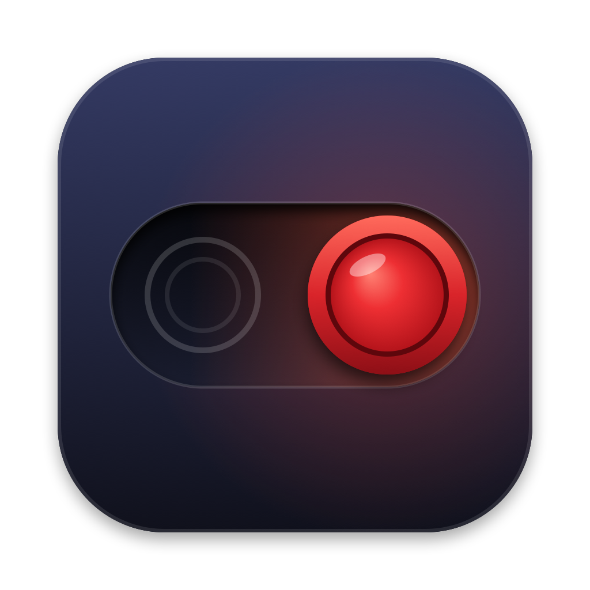

# Arcade Stick Mode



A macOS menu bar app that makes an **8BitDo Arcade Controller** work in **Fightcade**, and lets you switch it back for Steam and everything else.

## The problem

You connect an 8BitDo Arcade Controller to a Mac over Bluetooth in Switch mode. It works in Steam and in native Mac games. Then you open Fightcade, go to *Map Game Inputs*, press a button on the stick, and nothing happens.

The cause:

- In Switch mode the stick identifies itself as a Nintendo Switch Pro Controller.
- macOS supports that controller natively, and as part of that it switches the controller into a Nintendo-specific data format.
- Fightcade's emulators run through a bundled copy of Wine. Wine finds the stick, but it can only read standard gamepad data, so it sees a controller whose buttons never change.

## What this app does

It tells the stick to send standard gamepad data again, which Wine can read. Because Steam and native games want the Nintendo format, it is a toggle rather than a permanent change.

The app lives in the menu bar as a game controller icon: filled when the stick is in Fightcade mode, outlined when it is in Switch mode. The menu has three settings:

| Setting | What it does |
|---|---|
| **Automatic** (default) | Fightcade mode while Fightcade is open, Switch mode the rest of the time |
| **Fightcade mode** | Always standard gamepad data |
| **Switch mode** | Always the macOS default, for Steam and other games |

It re-applies the right mode whenever the stick reconnects, and quitting the app returns the stick to Switch mode. Nothing is changed permanently: turning the stick off and on also resets it.

## Requirements

- macOS 13 or later, Apple Silicon or Intel
- The stick connected over **Bluetooth** in **Switch mode** (it shows up in Bluetooth settings as "Arcade Controller")

## Install

### Download the app

1. Download the `Arcade-Stick-Mode` zip from the [latest release](https://github.com/liunev/arcade-stick-mode/releases/latest).
2. Unzip it and move **Arcade Stick Mode** to your Applications folder.
3. Open it. A game controller icon appears in the menu bar.

The app is signed with a Developer ID and notarized by Apple, so it opens without a Gatekeeper warning beyond the usual "downloaded from the internet" confirmation.

### Or build it from source

This needs the Xcode Command Line Tools (`xcode-select --install`).

```bash
git clone https://github.com/liunev/arcade-stick-mode.git
```

```bash
cd arcade-stick-mode
```

```bash
make install
```

This builds the app, copies it to `~/Applications/Arcade Stick Mode.app` and starts it.

### Start it at login

Add the app under **System Settings → General → Login Items**.

## Use it with Fightcade

1. Connect the stick over Bluetooth and make sure Arcade Stick Mode is running.
2. Open Fightcade. In Automatic, the menu bar icon becomes filled.
3. Start a game, open **Input → Map Game Inputs**, double-click a row and press the button on the stick.

If the emulator still does not react, close the game window and launch the game again, so the emulator looks for controllers with the stick connected.

A classic six-button layout for Street Fighter style games:

| Game input | Button on the stick |
|---|---|
| Up / Down / Left / Right | the four direction buttons |
| Weak / Medium / Strong Punch | top row, buttons 1 / 2 / 3 |
| Weak / Medium / Strong Kick | bottom row, buttons 1 / 2 / 3 |
| Start | Start / Plus |
| Coin | Select / Minus |

## Uninstall

Quit the app from its menu and delete **Arcade Stick Mode** from your Applications folder. If you built it from source, `make uninstall` in the cloned folder does the same.

## What it has been tested with

- 8BitDo Arcade Controller, Switch mode, Bluetooth
- macOS 26.5 on Apple Silicon
- Fightcade 2 with its FBNeo emulator (bundled Wine 5.0)

The Intel half of the release build has only been run under Rosetta, not on an Intel Mac.

The app acts on any Bluetooth controller that identifies as a Switch Pro Controller, so it may also help with a real Pro Controller or other 8BitDo controllers in Switch mode. Those are untested.

## Limitations

- **Bluetooth only.** It does nothing for the 2.4G receiver or a USB cable.
- **The app has to be running.** macOS puts the stick back in Switch mode on every reconnect, and the app is what switches it again.
- **Automatic follows the Fightcade app**, not individual games. While Fightcade is open, the stick stays in Fightcade mode; choose *Switch mode* from the menu if you want to play something else without closing Fightcade.

## How it works

Over Bluetooth, a Switch Pro Controller's HID descriptor describes its buttons, hat and sticks in input report `0x3F`. macOS's game controller service switches the controller to report `0x30` instead, which the descriptor declares only as vendor-defined bytes. Wine's DirectInput reads the controller through IOKit HID, so it enumerates 16 buttons, 4 axes and a hat that never update.

The app opens the controller with `IOHIDManager` and sends the Switch "set input report mode" subcommand (`0x03`) in output report `0x01`, with argument `0x3F` for standard HID reports or `0x30` to restore the macOS default. It then watches the incoming report type and sends the command again if macOS or a reconnect changes it back.

The whole app is one Swift file: [ArcadeStickMode.swift](ArcadeStickMode.swift).

## Making a release

For maintainers. `make release` builds a universal app, signs it with a Developer ID Application certificate, notarizes it, staples the ticket and writes the zip to `dist/`. It expects the certificate in the keychain and notarization credentials saved once under the profile name `arcade-stick-mode`:

```bash
xcrun notarytool store-credentials arcade-stick-mode
```

## License

MIT. See [LICENSE](LICENSE).

This project is not affiliated with 8BitDo, Nintendo or Fightcade.
